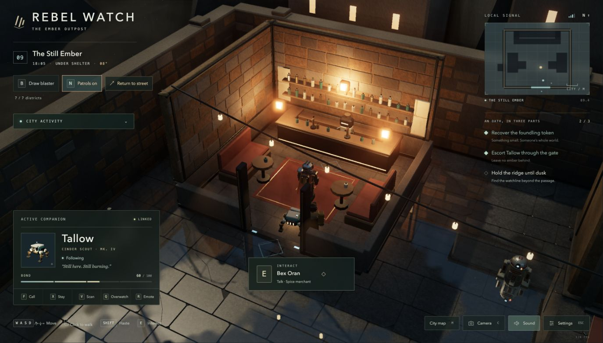
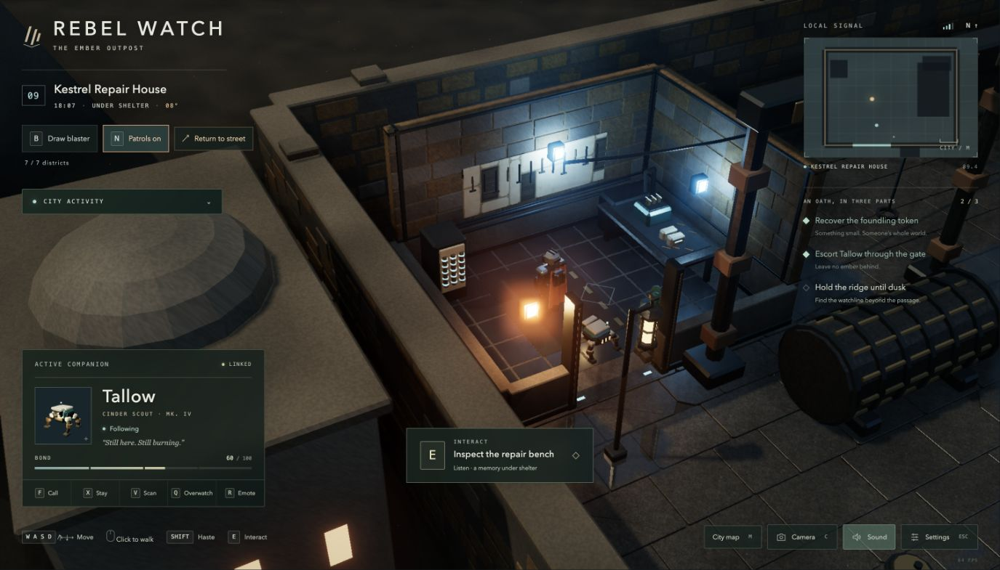

<p align="center">
  <a href="https://rebelwatch.newsfromskippy.com/">
    
  </a>
</p>

<p align="center"><em>Promotional concept artwork · The gameplay captures below show the running game.</em></p>

<p align="center">
  <strong>A small outpost. A stubborn light. A rebellion worth keeping alive.</strong><br>
  A playable Star Wars fan adventure, built for the browser.
</p>

<p align="center">
  <a href="https://rebelwatch.newsfromskippy.com/"><strong>▶ ENTER THE EMBER OUTPOST</strong></a>
  &nbsp; · &nbsp; <a href="#field-captures">Gameplay gallery</a>
  &nbsp; · &nbsp; <a href="#launch-from-your-own-hangar">Run locally</a>
  &nbsp; · &nbsp; <a href="#flight-controls">Controls</a>
</p>

<p align="center">
  <a href="https://github.com/GJBOW1/rebel-watch/actions/workflows/checks.yml"></a>
  
  
  
</p>

---

## Incoming transmission

> **EMBER OUTPOST // LOCAL SIGNAL: HOLDING**
>
> The rain has passed. The Empire has not.
>
> Under the lanterns, a courier keeps moving. A mechanic keeps a door open. A little scout droid refuses to leave your side. Somewhere above the rooftops, another ship finds its way home.
>
> Walk the streets. Listen to the people. Stand with the Jedi when the patrols close in.
>
> *Leave no ember behind.*

**Rebel Watch** is an atmospheric, high-isometric exploration game about a lived-in frontier city and the small loyalties that make it worth defending. Wander through wet stone courtyards, enter furnished buildings, meet residents, watch ships arrive overhead, and choose whether to join the fighting.

**Play on a computer with a keyboard and mouse.** Choose **Enter the courtyard** to begin and enable audio. No account or installation is needed for the hosted game.

## Field captures

These are **actual, unretouched screenshots from the running game**.


<p align="center"><em>The Ninth Courtyard · Your first steps into the outpost.</em></p>

<table>
  <tr>
    <td width="50%"></td>
    <td width="50%"></td>
  </tr>
  <tr>
    <td align="center"><strong>Traffic above the rooftops</strong><br>Shuttles arrive, settle, and depart on their own schedules.</td>
    <td align="center"><strong>A little shelter from the Empire</strong><br>Walk inside The Still Ember and hear a local story.</td>
  </tr>
</table>



<p align="center"><em>Kestrel Repair House · Every worn machine has another journey in it.</em></p>

## Your corner of the galaxy

| Signal | What you will find |
| --- | --- |
| **Seven connected districts** | Courtyards, market lanes, salvage streets, a landing district, and a distant watchpost. The city spans roughly five times the original courtyard slice. |
| **Three open doors** | The Still Ember cantina, Kestrel Repair House, and the Oath Archive. Walk through real thresholds as roofs and near walls reveal the rooms. |
| **Sixteen residents** | Humans, Twi'leks, protocol droids, and astromechs with walking routes and 48 authored conversation lines. |
| **Two working flight schedules** | Original shuttles and freighters approach rooftop pads, land, wait, take off, and depart. |
| **A city under occupation** | Stormtrooper patrols and occasional Jedi encounters. Watch safely, or draw your blaster and join the Jedi. |
| **A quiet score** | Original synthesized strings, horn, woodwind, and harp, with a restrained battle accompaniment. Music has its own volume and mute controls. |
| **A camera worth wandering with** | Follow the traveler, then orbit, pan, and zoom in free camera to explore the city from above. |

### Meet Tallow

**Cinder Scout · Mk. IV**<br>
*“Still here. Still burning.”*

Tallow is a small, four-legged scout with a boxy frame and a warm amber eye. It physically follows you around obstacles and through doorways. Successful interactions build trust, bringing it closer and warming its chirps.

| Command | Tallow's response |
| --- | --- |
| **F — Call** | Hustles over and waits beside you for a moment. |
| **X — Stay / follow** | Plants its feet, then resumes following when called out of hold. |
| **V — Scan** | Sweeps nearby interactables with a visible cone and a soft ping. |
| **E — Fetch** | Retrieves the marked foundling token and carries it back to you. |
| **Q — Overwatch** | Moves to a flank position and warns about nearby patrols. |
| **R — Emote** | Opens salute, spin, warning growl, and proud chirp. Choose with **1–4**. |

### An oath, in three parts

1. **A name returned.** Find the lost foundling token in the west court and ask Tallow to retrieve it.
2. **No one left at the gate.** Escort your companion through the Sundered Line.
3. **Keep the last light.** Reach Emberwatch Ridge together and hold the watchline until dusk.

Glowing terminals, Morrow's stationary salvage machine, and interior objects carry additional field notes. Approach and press **E** to listen.

## Flight controls

| Input | Action |
| --- | --- |
| **WASD / arrow keys** | Move relative to the camera. |
| **Click the ground** | Walk to a destination. |
| **Shift** | Move faster. |
| **E** | Talk, inspect, use a doorway, or ask Tallow to fetch the nearby token. |
| **B** | Draw or holster the blaster. |
| **Mouse + click / Space** | Aim and fire while the blaster is drawn. |
| **J** | Join the Jedi or stand down. Hitting a trooper also joins the fight. |
| **N** | Enable or disable stormtrooper encounters. |
| **C** | Enter or leave free camera. Drag to orbit, Shift-drag to pan, scroll to zoom, **R** to recenter. |
| **M** | Open the city map and choose a district, building, or clear street to walk to. |
| **Esc** | Quality, reduced motion, sound, music, photo capture, and reset. |

The **City Activity** panel controls residents, ship traffic, requested encounters, and rooftop ship-watching. Observers are safe from crossfire. Standing down restores the peaceful exploration state.

## Launch from your own hangar

Use **Node.js 22.12 or later** and npm.

```bash
git clone https://github.com/GJBOW1/rebel-watch.git
cd rebel-watch
npm ci
npm run dev
```

Open the local URL printed by Vite, normally **http://127.0.0.1:5173/**. The authored runtime models and textures are included; Blender is only needed if you want to rebuild the art.

```bash
npm test       # Simulation, navigation, interiors, combat, residents, traffic, and score
npm run build  # TypeScript validation and a production build in dist/
```

**84 automated tests pass in the current playable release.** The GitHub **Flight checks** workflow repeats the tests and production build for pushes and pull requests.

The renderer targets smooth desktop play with instanced population meshes, bounded effects, quality settings, and visibility-aware audio. Sampled ship-watching runs measured approximately **65–71 FPS** at High quality with a 2061×1252 framebuffer on the development machine. Results depend on hardware and browser; see the [verification report](docs/verification.md).

### Inside the workshop

| File / directory | Purpose |
| --- | --- |
| [`src/main.ts`](src/main.ts) | Scene loading, rendering, camera, input, and system integration. |
| [`src/simulation.ts`](src/simulation.ts) | Navigation, companion behavior, bond, and the original oath. |
| [`src/city-life.ts`](src/city-life.ts) | Residents, routes, conversations, and personal space. |
| [`src/air-traffic.ts`](src/air-traffic.ts) | Continuous rooftop flight schedules and landing states. |
| [`src/street-battle.ts`](src/street-battle.ts) | Patrols, Jedi encounters, and optional player participation. |
| [`src/music.ts`](src/music.ts) | The original procedural score, [Lanterns Beyond the Rim](docs/score.md). |
| [`tools/`](tools/) | Reproducible Blender generators, MCP client, verification probe, and release packaging. |
| [`art/`](art/) | Editable Blender masters. |
| [`public/assets/`](public/assets/) | Authored GLBs, image-generated textures, and concept references. |

The art pipeline runs through **Blender MCP**: generate concepts and texture maps, model and export in Blender, then inspect the result in the actual game. No marketplace mesh kits are used. See the [art pipeline](docs/art-pipeline.md) and [population design notes](docs/population-art.md) for reproducible steps and appearance references.

The header is promotional artwork made with built-in Codex image generation. Its [exact prompt and provenance](docs/readme-art.json) are included. The gallery images are untouched game captures.

<details>
<summary><strong>Preparing a static deployment</strong></summary>

Build the project, then serve the contents of `dist/` from a static web host. Keep the site at the domain root so `/assets/` URLs resolve correctly.

For the smaller production package used by the hosted game:

```bash
npm run build
python3 tools/package_release.py ./release
```

The packager shares byte-identical textures across models and writes gzip companions without altering texture pixels or geometry. Configure your host to serve precompressed files only when the client accepts gzip. The normal uncompressed files remain available. Host credentials, raw logs, and machine-specific deployment configuration are excluded from this repository.

</details>

## A fan-made spark

Rebel Watch is an **unofficial Star Wars fan project**, unaffiliated with Lucasfilm or Disney. Star Wars names and recognizable designs belong to their respective owners. The traveler, Tallow, outpost architecture, spacecraft arrangements, writing, modeled assets, and synthesized score were created for this project; no film music or downloaded character meshes are included.

The original experience brief was inspired by the AFTERLIGHT courtyard demo shared by [birdabo](https://x.com/birdabo/status/2096101381925114327) and [anshuc](https://x.com/anshuc/status/2096008083826725132).

---

<p align="center">
  <strong>THE WATCH HOLDS. THE EMBER LIVES.</strong><br>
  <a href="https://rebelwatch.newsfromskippy.com/">Take the next step into the outpost →</a>
</p>
