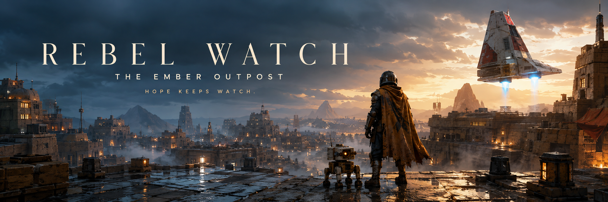
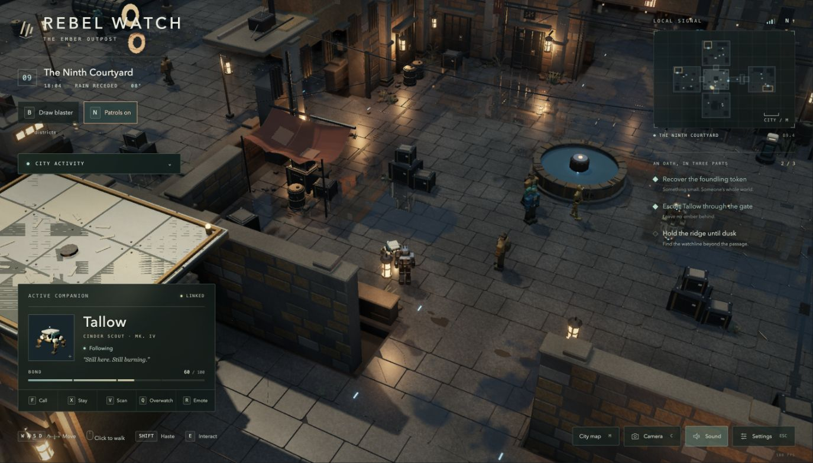
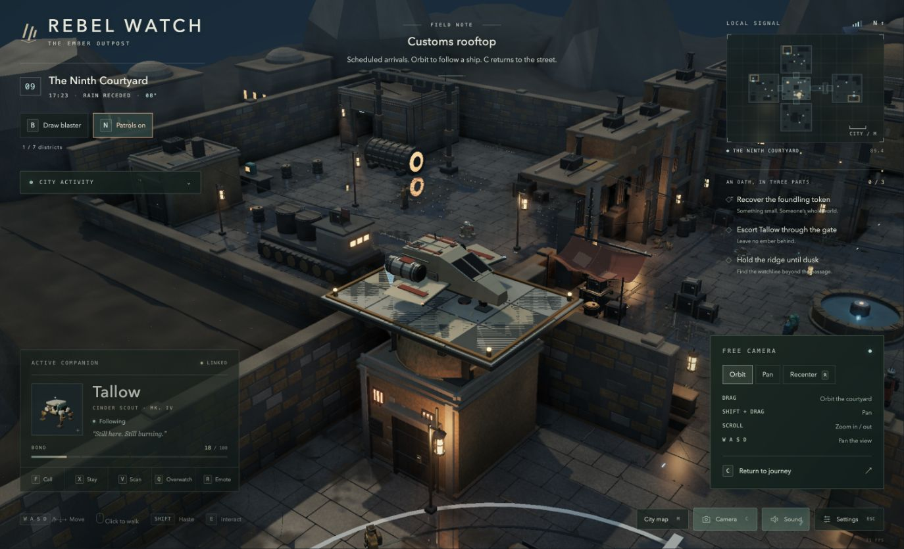
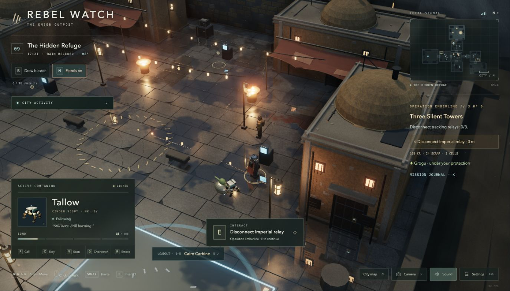
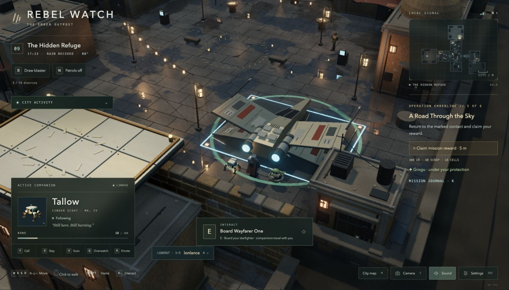
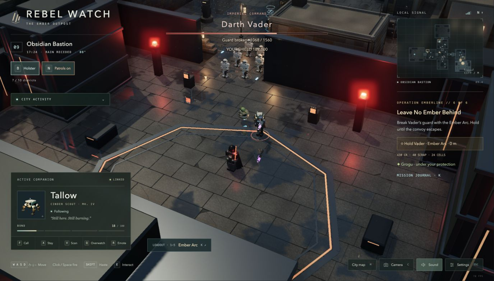
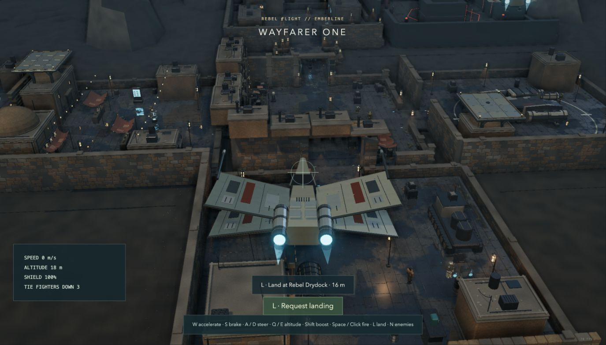
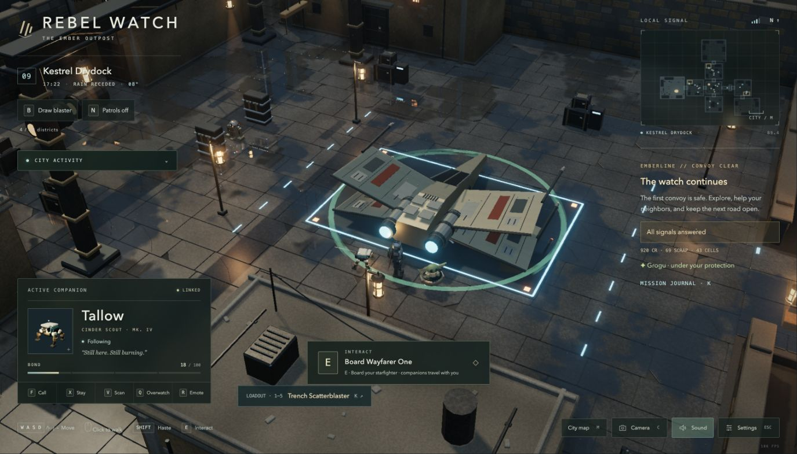

<p align="center">
  <a href="https://rebelwatch.newsfromskippy.com/">
    
  </a>
</p>

<p align="center"><em>Promotional concept artwork · The gameplay captures below show the running game.</em></p>

<p align="center">
  <strong>A small outpost. A stubborn light. A rebellion worth keeping alive.</strong><br>
  A playable Star Wars fan adventure, built for the browser.
</p>

<p align="center">
  <a href="https://rebelwatch.newsfromskippy.com/"><strong>▶ ENTER THE EMBER OUTPOST</strong></a>
  &nbsp; · &nbsp; <a href="#field-captures">Gameplay gallery</a>
  &nbsp; · &nbsp; <a href="#launch-from-your-own-hangar">Run locally</a>
  &nbsp; · &nbsp; <a href="#flight-controls">Controls</a>
</p>

<p align="center">
  <a href="https://github.com/GJBOW1/rebel-watch/actions/workflows/checks.yml"></a>
  
  
  
</p>

---

## Incoming transmission

> **EMBER OUTPOST // LOCAL SIGNAL: HOLDING**
>
> The rain has passed. The Empire has not.
>
> Under the lanterns, a courier keeps moving. A mechanic keeps a door open. A little scout droid refuses to leave your side. Somewhere above the rooftops, another ship finds its way home.
>
> Walk the streets. Listen to the people. Stand with the Jedi when the patrols close in.
>
> *Leave no ember behind.*

**Rebel Watch** is an atmospheric, high-isometric exploration game about a lived-in frontier city and the small loyalties that make it worth defending. **Operation Emberline** adds a linked Rebellion campaign: rescue Grogu, help two hidden Jedi open an escape route, break Imperial defenses, and take the fight above the rooftops in your own starfighter. Between missions, wander the wet streets with Tallow, enter furnished buildings, meet residents, and choose whether to join the ambient fighting.

**Play on a computer with a keyboard and mouse.** Choose **Enter the courtyard** to begin and enable audio. No account or installation is needed for the hosted game.

## Field captures

These are **actual, unretouched screenshots from the running game**. The Operation Emberline captures show the refuge, a completed fighter landing, and the final confrontation; the courtyard and interior images preserve views from the preceding city release.



<p align="center"><em>The Ninth Courtyard · Your first steps into the outpost.</em></p>

<table>
  <tr>
    <td width="50%"></td>
    <td width="50%"></td>
  </tr>
  <tr>
    <td align="center"><strong>Traffic above the rooftops</strong><br>Shuttles arrive, settle, and depart on their own schedules.</td>
    <td align="center"><strong>A little shelter from the Empire</strong><br>Walk inside The Still Ember and hear a local story.</td>
  </tr>
</table>


<p align="center"><em>Kestrel Repair House · Every worn machine has another journey in it.</em></p>

### Operation Emberline in the field



<p align="center"><em>The Hidden Refuge · One small life. A whole city keeping watch.</em></p>

<table>
  <tr>
    <td width="50%"></td>
    <td width="50%"></td>
  </tr>
  <tr>
    <td align="center"><strong>A road through the sky</strong><br>Three TIEs down. The refuge landing secured.</td>
    <td align="center"><strong>Leave no ember behind</strong><br>Break Vader’s guard and hold the convoy’s last escape route.</td>
  </tr>
</table>

<table>
  <tr>
    <td width="50%"></td>
    <td width="50%"></td>
  </tr>
  <tr>
    <td align="center"><strong>The city beneath your wings</strong><br>Lift off, explore the skyline and choose your next landing.</td>
    <td align="center"><strong>Everyone home</strong><br>Tallow and Grogu meet the traveler at the drydock after the convoy escapes.</td>
  </tr>
</table>

## Your corner of the galaxy

| Signal | What you will find |
| --- | --- |
| **Ten connected districts** | The Hidden Refuge, Kestrel Drydock, and Obsidian Bastion extend the existing city. Connected area available to the player grows from **2,869.89 to 6,020.97 m²** — **2.10×** the previous seven-district city, measured with collision clearance. |
| **Operation Emberline** | Six linked main quests, seven skippable scenes rendered in the game, explicit objectives and reward claims, a mission journal, and browser-local campaign saves. |
| **Two small companions** | Tallow keeps following throughout the adventure. Rescue Grogu and escort him to safety; he remains beside you after the campaign. |
| **Your own starfighter** | Board Wayfarer One, steer and boost above the city, fight Imperial TIEs, and land at the drydock or refuge. Free flight is available from the start. |
| **Two major confrontations** | Break the Warden’s command shield with an ion weapon, then use the Ember Arc to force Vader to retreat while the Jedi convoy escapes. |
| **Five weapons to earn and equip** | Main rewards supply the boss-breaking upgrades. Three optional contracts add resources, alternate blasters, and a shield improvement. |
| **Three open doors** | The Still Ember cantina, Kestrel Repair House, and the Oath Archive. Walk through real thresholds as roofs and near walls reveal the rooms. |
| **Sixteen residents** | Humans, Twi'leks, protocol droids, and astromechs with walking routes and 48 authored conversation lines. |
| **Two working flight schedules** | Original shuttles and freighters approach rooftop pads, land, wait, take off, and depart. |
| **A city under occupation** | Stormtrooper patrols and occasional Jedi encounters. Watch safely, or draw your blaster and join the Jedi. |
| **A quiet score** | Original synthesized strings, horn, woodwind, and harp, with a restrained battle accompaniment. Music has its own volume and mute controls. |
| **A camera worth wandering with** | Follow the traveler, then orbit, pan, and zoom in free camera to explore the city from above. |

### Operation Emberline

Maera Venn is waiting inside **The Still Ember**. The Empire has turned the old relay network into a register of the people it intends to take. Two Jedi are sheltering Grogu beyond the northern lamps, and a Rebel convoy needs a way out.

Open **K → Main Story**, choose the marked contact, then press **E** when you arrive. Accept a chapter, carry out its objective, and return to claim its reward. The journal also holds **Side Contracts** and your **Armory**. Progress saves automatically in this browser.

| Chapter | Your part in the escape |
| --- | --- |
| **1 · A Signal Beneath the Ash** | Hear Maera’s briefing and collect the emergency supplies. |
| **2 · The Smallest Light** | Rescue Grogu at the refuge and physically escort him to Jedi Ryn at the Oath Archive. |
| **3 · Three Silent Towers** | Disconnect three Imperial tracking relays and bring their cores back for the **Ionlance**. |
| **4 · The Warden’s Last Order** | Equip an ion weapon, break the Warden’s shield core, and dodge the marked attacks. |
| **5 · A Road Through the Sky** | Accept the mission, defeat three TIE fighters in your ship, and land at the refuge to claim the **Ember Arc**. Earlier free-flight victories and emergency returns do not count. |
| **6 · Leave No Ember Behind** | Use the Ember Arc to break Vader’s guard and hold the bastion until the convoy escapes. Signal the final transport to finish the story. |

Seven scenes use the real game world, moving cameras, and original dialogue. **Skip scene / Esc** ends the scene without completing its mission. Boss defeats offer free checkpoint retries; resources and earned weapons remain yours. After the ending, Grogu stays with you and exploration remains open.

### The armory and the work between missions

| Weapon | How it reaches your hands |
| --- | --- |
| **Cairn Carbine · Tier I** | Your starting blaster. |
| **Trench Scatterblaster · Tier I** | Recover three drydock caches for **The Dockworkers’ Reserve**. |
| **Patchwork Arc Repeater · Tier II** | Repair the stranded astromech in **One More Good Turn**. |
| **Ionlance · Tier II** | Required main-story reward from **Three Silent Towers**; breaks the Warden’s core. |
| **Ember Arc · Tier III** | Required main-story reward from **A Road Through the Sky**; breaks Vader’s guard. |

The third optional contract, **Hands That Still Heal**, carries medicine from the cantina to the refuge and increases your ground and boss shield capacity from **100 to 120**. Your ship keeps its separate 100-point shield. Credits, scrap, and energy cells come from completed work. The Armory’s field repair costs **20 credits and 2 cells**; the astromech repair uses **6 scrap**. Every main-story weapon is earned on the main path, so none of the three optional contracts is required to finish Operation Emberline.

Equip owned weapons in **K → Armory**, or use **1–5** in the order shown by your loadout. Ordinary blaster fire cannot break the bosses’ protected guards. See the [campaign guide](docs/campaign-story.md) for the full progression and checkpoint rules.

### Meet Tallow

**Cinder Scout · Mk. IV**<br>
*“Still here. Still burning.”*

Tallow is a small, four-legged scout with a boxy frame, cyan optics, and a warm amber core. It physically follows you around obstacles and through doorways. Successful interactions build trust, bringing it closer and warming its chirps.

| Command | Tallow's response |
| --- | --- |
| **F — Call** | Hustles over and waits beside you for a moment. |
| **X — Stay / follow** | Plants its feet, then resumes following when called out of hold. |
| **V — Scan** | Sweeps nearby interactables with a visible cone and a soft ping. |
| **E — Fetch** | Retrieves the marked foundling token and carries it back to you. |
| **Q — Overwatch** | Moves to a flank position and warns about nearby patrols. |
| **R — Emote** | Opens salute, spin, warning growl, and proud chirp. Choose with **1–4**. |

### An oath, in three parts

1. **A name returned.** Find the lost foundling token in the west court and ask Tallow to retrieve it.
2. **No one left at the gate.** Escort your companion through the Sundered Line.
3. **Keep the last light.** Reach Emberwatch Ridge together and hold the watchline until dusk.

This original oath remains a separate companion activity alongside Operation Emberline. Glowing terminals, Morrow’s stationary salvage machine, and interior objects carry additional field notes. Approach and press **E** to listen.

## Flight controls

### On the street

| Input | Action |
| --- | --- |
| **WASD / arrow keys** | Move relative to the camera. |
| **Click the ground** | Walk to a destination. |
| **Shift** | Move faster. |
| **E** | Accept or act on a mission, claim a reward, board your ship, talk, inspect, use a doorway, or ask Tallow to fetch the nearby token. |
| **K** | Open the mission journal: Main Story, Side Contracts, and Armory. |
| **1–5** | Equip an owned weapon in loadout order; while the emote wheel is open, **1–4** select an emote instead. |
| **B** | Draw or holster the blaster. |
| **Mouse + click / Space** | Aim and fire while the blaster is drawn. |
| **J** | Join the Jedi or stand down. Hitting a trooper also joins the fight. |
| **N** | Toggle enemies: street patrols and Imperial fighters; an active boss encounter pauses when enemies are off. |
| **C** | Enter or leave free camera. Drag to orbit, Shift-drag to pan, scroll to zoom, **R** to recenter. |
| **M** | Open the city map and choose a district, building, or clear street to walk to. |
| **Esc** | Skip the active cinematic, close the journal or another panel, or open settings for quality, reduced motion, sound, music, photo capture, and reset. |

The **City Activity** panel controls residents, scheduled traffic, requested ambient encounters, and rooftop ship-watching. Ambient observers are safe from crossfire. **J** returns an ambient participant to protected observer mode; boss encounters have their own checkpoint and retreat controls.

### In Wayfarer One

Your fighter waits at **Kestrel Drydock**. Approach its boarding ramp with Tallow nearby and press **E**. Once rescued, Grogu travels aboard too. Takeoff finishes before manual flight begins.

| Input | Flight action |
| --- | --- |
| **W / S** | Accelerate / brake to a hover. |
| **A / D** | Steer left / right. |
| **Q / E** | Climb / descend. |
| **Shift** | Boost. |
| **Space / left click** | Fire forward at Imperial fighters. |
| **L** | Request autoland at the nearest marked pad. |
| **N** | Toggle enemies. |

To land, approach the **drydock or refuge pad** within **32 metres** and brake below **18 m/s**. Follow the HUD’s landing guidance, then press **L**. Autoland aligns the ship and brings it down to the pad before you disembark. Losing your ship’s shield initiates an emergency return; boarding again restores it. Emergency returns preserve mission kills but do not satisfy the campaign’s normal refuge-landing objective. See the [pilot guide](docs/pilot-controls.md) for flight details.

## Launch from your own hangar

Use **Node.js 22.12 or later** and npm.

```bash
git clone https://github.com/GJBOW1/rebel-watch.git
cd rebel-watch
npm ci
npm run dev
```

Open the local URL printed by Vite, normally **http://127.0.0.1:5173/**. **127.0.0.1 means localhost: your own computer. It is a universal loopback address, not the developer’s public IP or the hosted game.** To play online, use [rebelwatch.newsfromskippy.com](https://rebelwatch.newsfromskippy.com/).

The authored runtime models and textures are included; Blender is only needed if you want to rebuild the art.

```bash
npm test       # Campaign, bosses, flight, companions, navigation, interiors, residents, and score
npm run build  # TypeScript validation and a production build in dist/
```

**Operation Emberline is live at the hosted link.** All six main chapters, the ending and all three optional contracts were completed through ordinary local-browser controls; reloading preserved objectives, all five weapons, loadout, resources and the 120-point ground shield. **The final source passes 141/141 tests and the TypeScript/Vite production build.** The public browser loaded every runtime model, entered the cantina, accepted the first chapter, played its cinematic and claimed its reward to unlock chapter two, with no logged warnings or errors. The [GitHub Flight checks workflow](https://github.com/GJBOW1/rebel-watch/actions/workflows/checks.yml) runs the tests and build for each push and pull request.

The renderer targets smooth desktop play with instanced population meshes, bounded effects, quality settings, and visibility-aware audio. At **High quality and 2061×1176**, two final flight-camera samples measured **73.34 and 113.05 rolling FPS**; two rooftop samples measured **66.06 and 69.79 FPS**. The public build at **High quality, 2268×1294**, measured **76.19 FPS / 17.2 ms p95** after the duplicate local playtest was closed. Earlier public samples with both game instances running averaged about 54 FPS. These observations do not establish a 60 FPS minimum; see the [verification report](docs/verification.md) for the full scope.

### Inside the workshop

| File / directory | Purpose |
| --- | --- |
| [`src/main.ts`](src/main.ts) | Scene loading, rendering, camera, input, and system integration. |
| [`src/simulation.ts`](src/simulation.ts) | Navigation, companion behavior, bond, and the original oath. |
| [`src/campaign.ts`](src/campaign.ts) | Six chapters, optional contracts, resources, equipment, and validated campaign saves. |
| [`src/campaign-combat.ts`](src/campaign-combat.ts) | Warden and Vader encounters, power requirements, warnings, and checkpoints. |
| [`src/expedition.ts`](src/expedition.ts) | Campaign, companions, weapons, bosses, flight, and save integration. |
| [`src/cinematics.ts`](src/cinematics.ts), [`src/campaign-ui.ts`](src/campaign-ui.ts) | In-engine story scenes, mission journal, loadout, and objective HUD. |
| [`src/grogu.ts`](src/grogu.ts) | Grogu’s continuous companion following. |
| [`src/pilot.ts`](src/pilot.ts), [`src/pilot-view.ts`](src/pilot-view.ts) | Player-controlled flight, TIE encounters, landing, and ship presentation. |
| [`src/city-life.ts`](src/city-life.ts) | Residents, routes, conversations, and personal space. |
| [`src/air-traffic.ts`](src/air-traffic.ts) | Continuous rooftop flight schedules and landing states. |
| [`src/street-battle.ts`](src/street-battle.ts) | Patrols, Jedi encounters, and optional player participation. |
| [`src/music.ts`](src/music.ts) | The original procedural score, [Lanterns Beyond the Rim](docs/score.md). |
| [`tools/`](tools/) | Reproducible Blender generators, MCP client, verification probe, and release packaging. |
| [`art/`](art/) | Editable Blender masters. |
| [`public/assets/`](public/assets/) | Authored GLBs, image-generated textures, and concept references. |

The art pipeline runs through **Blender MCP**: generate concepts and texture maps, model and export in Blender, then inspect the result in the actual game. No marketplace mesh kits are used. See the [art pipeline](docs/art-pipeline.md), [population design notes](docs/population-art.md), and [campaign art notes](docs/campaign-art.md) for reproducible steps and appearance references.

The header is promotional artwork made with built-in Codex image generation. Its [exact prompt and provenance](docs/readme-art.json) are included. The gallery images are untouched game captures.

<details>
<summary><strong>Preparing a static deployment</strong></summary>

Build the project, then serve the contents of `dist/` from a static web host. Keep the site at the domain root so `/assets/` URLs resolve correctly.

For the smaller production package used by the hosted game:

```bash
npm run build
python3 tools/package_release.py ./release
```

The packager shares byte-identical textures across models and writes gzip companions without altering texture pixels or geometry. Configure your host to serve precompressed files only when the client accepts gzip. The normal uncompressed files remain available. Host credentials, raw logs, and machine-specific deployment configuration are excluded from this repository.

</details>

## A fan-made spark

Rebel Watch is an **unofficial Star Wars fan project**, unaffiliated with Lucasfilm or Disney. Star Wars names and recognizable designs belong to their respective owners. The traveler, Tallow, outpost architecture, spacecraft arrangements, writing, modeled assets, and synthesized score were created for this project; no film music or downloaded character meshes are included.

The original experience brief was inspired by the AFTERLIGHT courtyard demo shared by [birdabo](https://x.com/birdabo/status/2096101381925114327) and [anshuc](https://x.com/anshuc/status/2096008083826725132).

---

<p align="center">
  <strong>THE WATCH HOLDS. THE EMBER LIVES.</strong><br>
  <a href="https://rebelwatch.newsfromskippy.com/">Take the next step into the outpost →</a>
</p>
